# Case state machine

Lifecycle is one of six independent tracks. Changing one track must not implicitly change another. Every accepted transition is atomic with its `case_events` append; invalid transitions return a conflict and do not mutate the case.

## Lifecycle states

`Submitted`, `Under Triage`, `Referred`, `Awaiting Response`, `Under Examination`, `Decision Recorded`, `Closed`, `Out of Scope`, `Transferred`, `Appeal Submitted`, `Under Appeal Review`, `Appeal Decided`.

`Transferred` is an administrative routing event/state marker: the prior lifecycle state is retained in event payload and restored after the target Bureau accepts it. This avoids losing whether the case was awaiting a response or under examination.

## Valid lifecycle transitions

```mermaid
stateDiagram-v2
  [*] --> Submitted
  Submitted --> Under_Triage: intake accepted
  Under_Triage --> Referred: refer to institution
  Under_Triage --> Under_Examination: retain at AICTE
  Under_Triage --> Out_of_Scope: reason + redirect
  Referred --> Awaiting_Response: referral sent
  Awaiting_Response --> Under_Examination: response received / response deadline expired
  Under_Examination --> Decision_Recorded: decision entered
  Decision_Recorded --> Closed: notice issued
  Closed --> Appeal_Submitted: eligible appeal filed
  Appeal_Submitted --> Under_Appeal_Review: Ombudsperson accepts
  Under_Appeal_Review --> Appeal_Decided: decision entered
  Appeal_Decided --> Closed: appeal dismissed / final
  Appeal_Decided --> Under_Examination: returned for further action
  Under_Triage --> Transferred: authorized Bureau transfer
  Referred --> Transferred: authorized transfer; preserve prior state
  Awaiting_Response --> Transferred: authorized transfer; referral remains visible
  Under_Examination --> Transferred: authorized transfer
  Transferred --> Under_Triage: target Bureau accepts; restore saved state by event
```

Any route transfer must specify destination Bureau, reason, actor, and prior lifecycle state. The original institution response remains visible to authorized actors after transfer.

## Explicitly invalid lifecycle transitions

- `Submitted` directly to any state except `Under Triage`.
- `Under Triage` directly to `Awaiting Response`, `Decision Recorded`, `Closed`, or appeal states.
- `Referred` directly to `Closed` or `Decision Recorded`; record response/decision steps first.
- `Awaiting Response` directly to `Closed`; a response or explicit timeout action returns it to examination.
- `Under Examination` directly to `Closed`; record a decision first.
- `Decision Recorded` back to `Under Examination` without an appeal decision or authorized correction event.
- `Closed` to any ordinary lifecycle state; only eligible appeal submission reopens review.
- `Out of Scope` to active processing; correction requires a privileged reopen event with reason, recorded as a new event (implementation must explicitly add this transition before enabling reopen).
- `Transferred` to a normal state without target acceptance and prior-state restoration.
- Any transition by student, faculty, college management, Regional Officer, Competent Authority, or Auditor unless a separate permission row grants the specific action.

## Other independent tracks

| Track | States and allowed changes |
|---|---|
| Verification | `Pending` → `Verified` / `Needs Review` / `Unable to Verify`; authorized AICTE verifier only. A later review may change verdict with a reasoned event. Never changes urgency or case acceptance. |
| Coordination | `No Overlap` → `Possible Overlap` → `Linked` / `Dismissed`; Bureau Head may reopen dismissed alert with reason and new evidence. |
| Deadline | `On Track` → `Nearing` → `Overdue`; pause only with reason; resume to computed state. Deadline job does not alter lifecycle. |
| Appeal | `Not Applicable` → `Eligible` → `Submitted` → `Under Review` → `Decided`; eligibility is computed from configured routing/rules, never from feedback rating. |
| Urgency/triage | `Untriaged` → `Triaged`, with urgent safety flag tracked independently. Out-of-scope requires reason and redirect. Verification status cannot lower priority. |

## Transition payload requirements

Persist actor and role, timestamp, prior/new lifecycle and track values, reason where required, destination Bureau/officer for transfer, expected next action/date, and referenced evidence IDs. Use optimistic `version` checks; a stale update is rejected and the caller reloads. State changes, audit event, and notification outbox intent are committed together.
